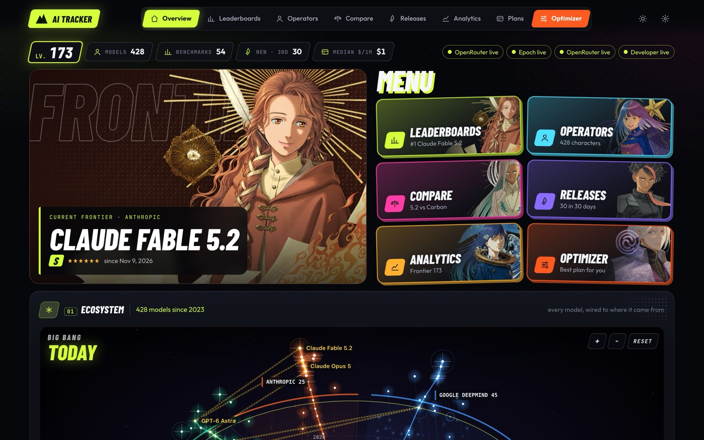
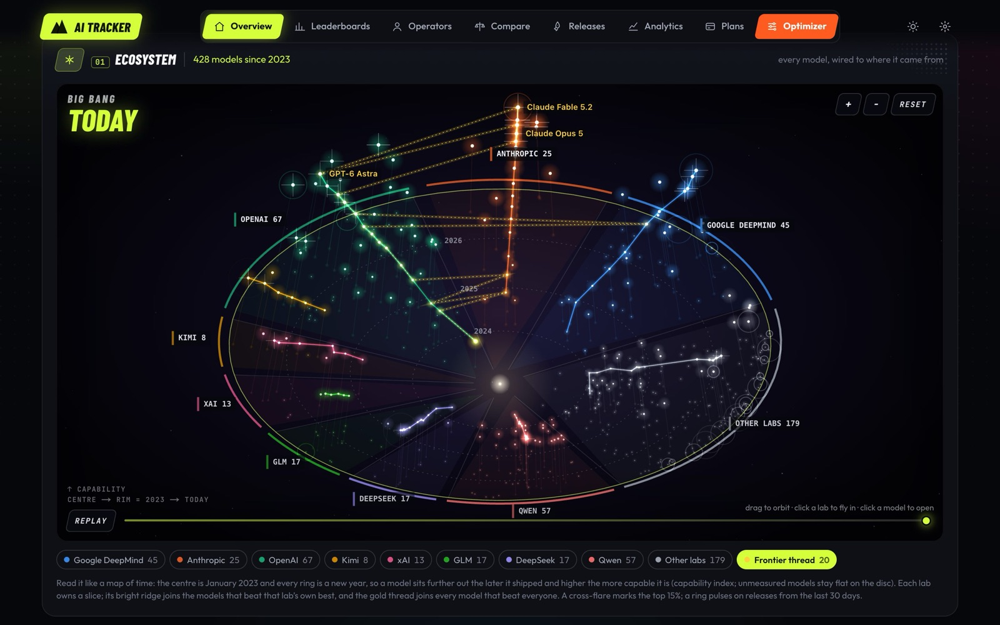
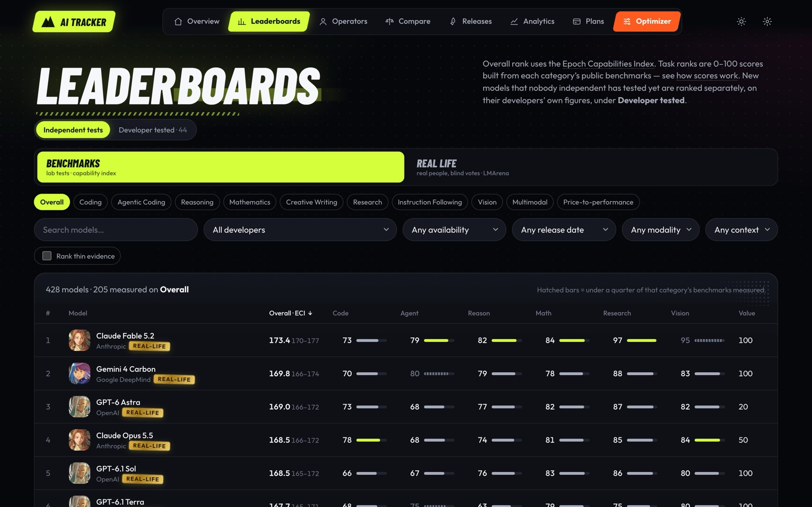
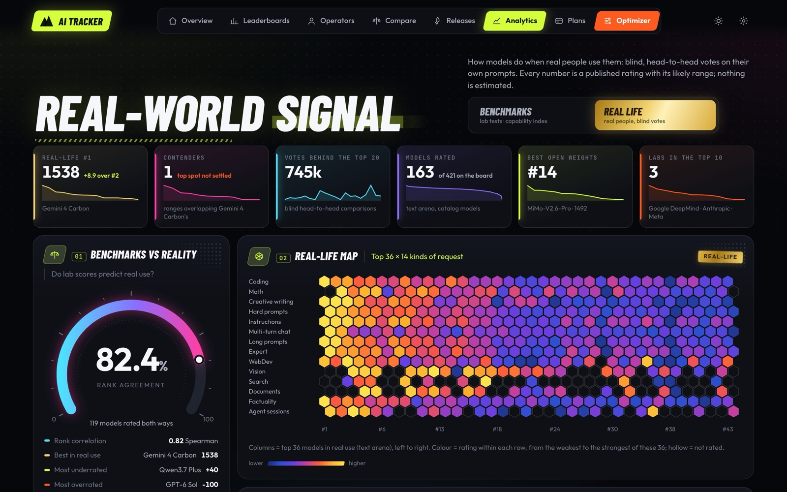
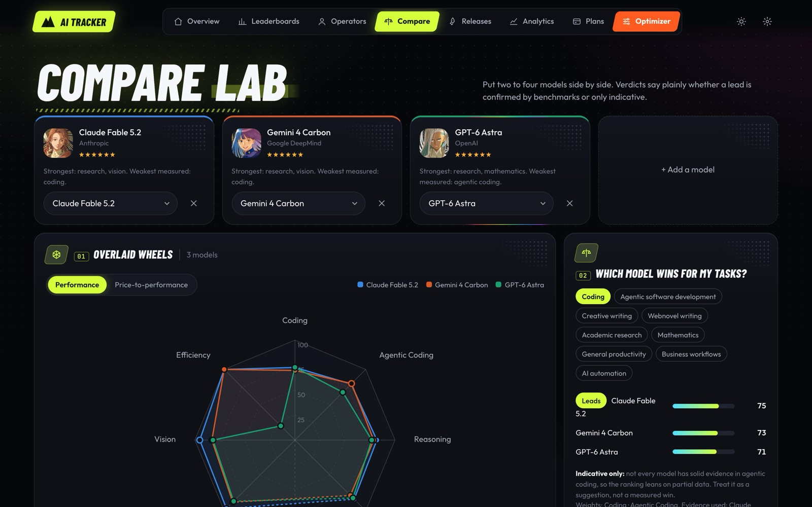
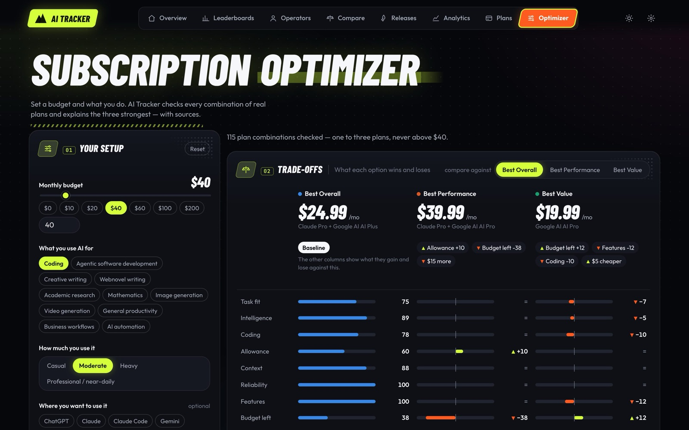
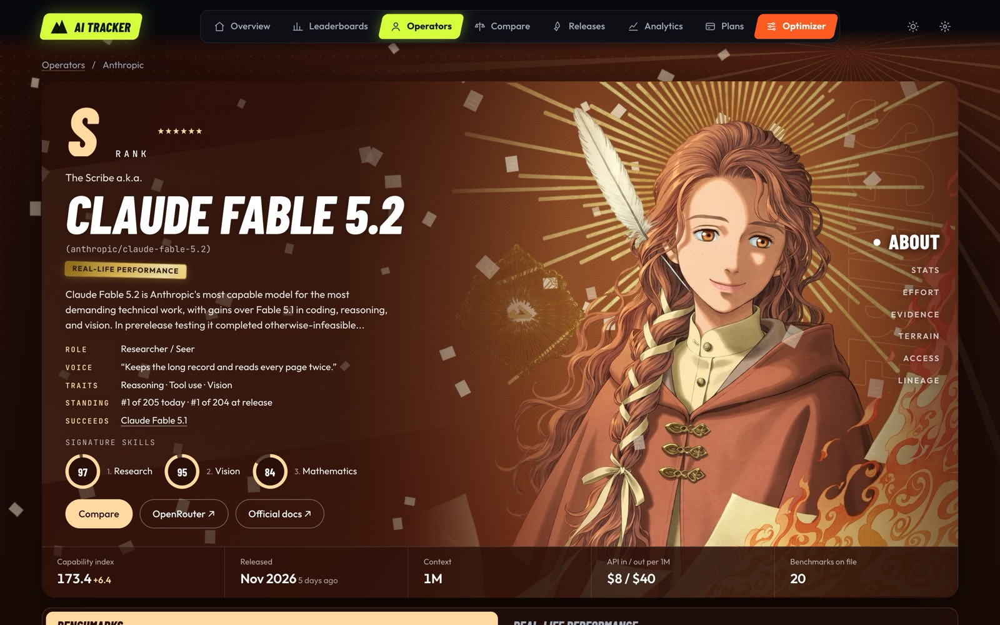

# AI Tracker

**A live guide to AI models: what each one is good at, what it costs, how it does with real people, and which subscription is worth paying for.**

### → Try it: [aitracker-theta.vercel.app](https://aitracker-theta.vercel.app) · free, no sign-up
### → Tell me what's wrong or missing: [give feedback](https://github.com/Paxie-5/ai-tracker/issues/new/choose)

## Try it in one minute

1. **Who is #1 right now?** The home page shows the current frontier model and how long it has held the spot.
2. **Scroll to the Big Bang map.** Drag to orbit, click a lab to fly in, click a model to open its profile.
3. **Compare two or three models** you actually use, then pick your tasks under *Which model wins for my tasks?*
4. **Put your monthly budget into the Optimizer** and see which mix of subscriptions it recommends, and why.

Then tell me what confused you, what looked wrong, or what you wished it did: [feedback](https://github.com/Paxie-5/ai-tracker/issues/new/choose).

## What it does

| | |
|---|---|
| **Every major model in one place** | 400+ models from 2023 to today, with API price, context size, release date and which lab made it. |
| **Leaderboards** | Overall and per task: coding, agentic coding, reasoning, maths, research, vision and more. Each overall score shows its likely range, not just a single number. |
| **Real-life performance** | How models do when real people use them, from blind head-to-head votes on their own prompts, next to how they do in lab tests. |
| **Compare Lab** | Two to four models side by side, with a plain verdict on whether a lead is confirmed by benchmarks or only indicative. |
| **Subscription Optimizer** | Set a budget and what you use AI for. It checks every combination of one to three real plans and explains the three strongest, with sources. |
| **Operators** | A profile page and an illustrated character for every model, with its stats, strengths, evidence and lineage. |
| **Releases and news** | New models, price changes and benchmark records as they happen, plus AI headlines. Rumours are labelled as rumours and never affect a score. |
| **Big Bang map** | A 3D map of every model since 2023: further out = released later, higher = more capable, each lab its own slice. |

<table>
<tr>
<td width="50%"> <b>Big Bang map.</b> The centre is January 2023 and each ring is a year. The gold thread joins every model that beat everyone before it.</td>
<td width="50%"> <b>Leaderboards.</b> Overall rank plus per-task scores. A hatched bar means under a quarter of that category's benchmarks were run.</td>
</tr>
<tr>
<td> <b>Real-world signal.</b> Do lab scores predict real use? Rank agreement, the most under- and over-rated models, and a map by kind of request.</td>
<td> <b>Compare Lab.</b> Overlaid skill wheels and a "which model wins for my tasks" verdict that says how solid the evidence is.</td>
</tr>
<tr>
<td> <b>Optimizer.</b> Best Overall, Best Performance and Best Value for your budget, with what each one gains and loses.</td>
<td> <b>Operator profile.</b> Every model gets a page: rank, signature skills, price, context, evidence and where it came from.</td>
</tr>
</table>

## How it works

### 1. Public data in, nothing invented

| What | Source |
|---|---|
| Model list, specs, API prices | [OpenRouter](https://openrouter.ai) public models API |
| Benchmark results, release dates, capability index | [Epoch AI Benchmarking Hub](https://epoch.ai/benchmarks), CC BY 4.0 |
| Real-life performance (blind votes) | [LMArena public leaderboard dataset](https://huggingface.co/datasets/lmarena-ai/leaderboard-dataset), CC BY 4.0 |
| Brand-new models nobody independent has tested yet | The developer's own published model card, clearly labelled *Developer tested* |
| News | Hacker News (Algolia API) and GDELT, both free and open |
| Subscription plans | Checked by hand against each provider's pricing page, each with a source link and a "verified on" date |

If a model has never been tested on something, the site says **unmeasured**. It never shows that as a zero or fills the gap with a guess.

### 2. It keeps itself up to date

- Every 6 hours, a scheduled GitHub Actions job pulls the model list, prices and benchmark results again.
- Every hour, a second job pulls the news and the real-life ratings.
- When anything changed, the job commits the new data, and the site rebuilds and redeploys itself.
- There is no AI anywhere in this pipeline, no database and no accounts. Every page is built from versioned data files, which keeps the site fast and free to host. Your settings stay in your own browser.

### 3. How scores are worked out

- **Each benchmark is rescaled on its own terms:** chance level = 0, perfect = 100. The original score, date and source link are kept and shown on the model's page.
- **Benchmarks differ in difficulty, and no model has run them all.** A plain average would flatter a model that was only tested on easy ones. So each benchmark gets a fitted difficulty (a one-parameter Rasch model), and a category score is the expected result across that category's whole set of benchmarks.
- **Overall rank is Epoch's Capabilities Index,** not a home-made blend, and it is shown with its range.
- **New models get their own board.** Until independent results arrive, a new model is ranked separately on its developer's own figures, with a *Developer tested* tape. The tape and the estimate disappear as soon as independent results exist.
- **Real life is kept apart from lab tests.** The real-life board uses only blind votes. When two models' rating ranges overlap, the site says the top spot is not settled. The Analytics page measures how well lab ranks and real-life ranks agree.

### 4. How the Optimizer decides

The Optimizer is a plain search, not an AI. It tries every combination of one to three plans that fits your budget. A plan only counts toward a tool if the provider documents that it works there, so a chat subscription is never counted as coding-tool access by assumption. For each pick it shows its reasoning, which models and tools you get, the restrictions, how it compares with paying for the API directly, and what a cheaper option would lose.

## Feedback wanted

This is an early project and I want honest reactions. The most useful kinds:

- **"This number is wrong."** Tell me the model, what the site shows and a link to the right figure. → [Data correction](https://github.com/Paxie-5/ai-tracker/issues/new?template=data-correction.yml)
- **"This broke" or "I couldn't find X."** → [Bug or confusion](https://github.com/Paxie-5/ai-tracker/issues/new?template=bug.yml)
- **"I wish it did Y."** → [Idea](https://github.com/Paxie-5/ai-tracker/issues/new?template=idea.yml)

## Data and credit

- Benchmark data: Epoch AI, "Capabilities & benchmarking", [epoch.ai/benchmarks](https://epoch.ai/benchmarks), CC BY 4.0. Third-party benchmarks in that hub keep their original terms.
- Real-life ratings: [LMArena leaderboard dataset](https://huggingface.co/datasets/lmarena-ai/leaderboard-dataset), CC BY 4.0.
- Model list and prices: [OpenRouter](https://openrouter.ai).
- The operator characters are unofficial personifications. They are not affiliated with or endorsed by any AI company or model developer.

## Built with

Next.js, React, TypeScript and three.js. Data refreshed by GitHub Actions; hosted on Vercel.

---

*The source code is private. This repository is the public showcase and the place for feedback.*
