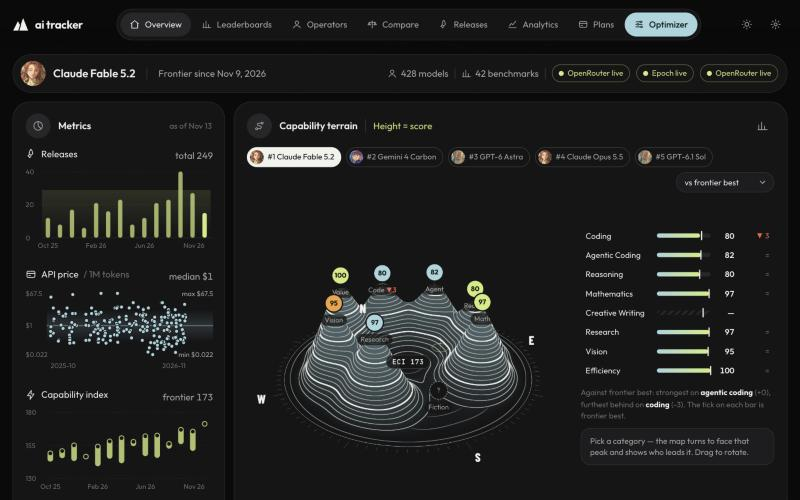

# AI Tracker

**A live guide to AI models: what each one is good at, what it costs, and which subscription is worth paying for.**

### → [aitracker-theta.vercel.app](https://aitracker-theta.vercel.app)

## What it does

- **Every major AI model in one place** — 400+ models with their price, context size and release date.
- **Real benchmark scores, never invented ones** — if a model has not been tested on something, the site says so instead of showing a zero.
- **Leaderboards and side-by-side comparison** — by coding, reasoning, maths, research, vision and more.
- **Brand-new models ranked from day one** — a separate "Developer tested" board uses each lab's own published figures, clearly labelled, until independent results arrive.
- **Subscription optimizer** — tell it your budget and it finds the best mix of plans.
- **A profile page for every model and every AI lab**, each with its own look.
- **Release feed** — new models, price changes and benchmark records as they happen.

## How it stays current

The site refreshes its own data every six hours and rebuilds itself. No AI is used to do it — just the public data below.

## Data and credit

- Model list and prices: [OpenRouter](https://openrouter.ai) public models API.
- Benchmark results: [Epoch AI Benchmarking Hub](https://epoch.ai/benchmarks), CC BY 4.0.
- Subscription plans: checked by hand against each provider's own pricing page.

## Built with

Next.js, React, TypeScript and three.js, hosted on Vercel.

---

*The source code is private. This page is a showcase only.*
